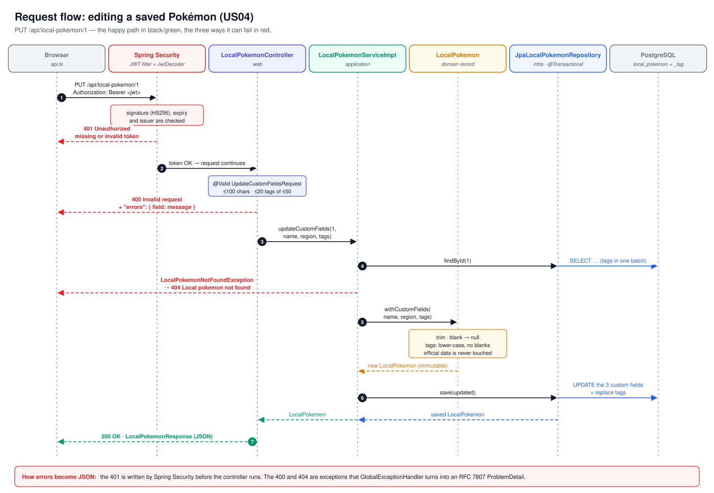

# Pokédex – Ballast Lane Java Exercise
*Presentation outline: what I built, how it is structured, and why*

Suggested length: about 25 minutes, then the code review.

| # | Section | Time |
|---|---|---|
| 1 | The project in one minute | 1 min |
| 2 | How I approached it | 3 min |
| 3 | Requirements → implementation | 2 min |
| 4 | Architecture | 5 min |
| 5 | Design decisions and trade-offs | 4 min |
| 6 | Live demo | 5 min |
| 7 | Tests and quality | 2 min |
| 8 | How I used generative AI | 2 min |
| 9 | Limitations and next steps | 1 min |

---

## 1. The project in one minute

- A **Spring Boot 4 / Java 25 REST API** that reads Pokémon from the public PokeAPI and lets users keep their own copy in **PostgreSQL**.
- The local copy adds **custom fields** that the PokeAPI does not have: a localized name, a region and tags.
- A **React + TypeScript** web app on top, with sign-in, the catalog, the detail view and the local collection.
- **Everything starts with one command:**

  ```bash
  docker compose up --build
  ```

  Then open http://localhost:3000 and sign in with `user` / `user`. Onix is already saved as demo data.

---

## 2. How I approached it

### Reading the brief

The brief says the evaluation focuses on **Clean Architecture, TDD and code quality**. That set my priorities:

- The backend gets most of the time. The frontend only has to cover every use case, as simply as possible.
- I started with the four user stories and left the extras (cache, users, Docker) for when the core worked.
- I wrote down the rules before writing code: dependencies point inward, the core has no Spring or JPA, and every use case starts with a failing test.

### The order I followed

1. **The core first, with no framework (US01).**
   - My first commit is a test for the list use case, with the PokeAPI behind a port (`PokemonCatalog`) and replaced by a mock.
   - That made me decide what the business needs (a page of summaries) before deciding how to get it.
2. **Then outward, one adapter at a time.**
   - First the PokeAPI adapter, tested with WireMock and real JSON responses.
   - Then the controller with `@WebMvcTest`, and the error handler.
   - Each layer was tested on its own before connecting it to the next.
3. **US02 (detail).**
   - The PokeAPI spreads one Pokémon over three endpoints, and the evolution chain is a recursive tree.
   - I kept that complexity inside the adapter, so the domain only sees a flat `PokemonDetail`.
4. **Making the external dependency safe before building on it.**
   - Cache, timeouts and turning PokeAPI failures into `503`.
   - Here a test that starts the whole application caught a missing bean that every unit test had missed. Since then I keep that test as a safety net.
5. **US03 (saving locally).** I chose separate domain records and JPA entities, and Flyway for the schema. Concurrency was a question here: two syncs at the same time could both pass the "already exists?" check. A unique constraint answers it, and I translate the violation into `409`.
6. **Authentication before US04.**
   - Editing data had to be protected, so users and JWT came first.
   - I used Spring Security's resource server instead of writing my own token filter: less code of mine in the most sensitive part.
7. **US04 and the rest of the CRUD.**
   - I chose `PUT` over `PATCH` because it is simpler to validate.
   - I made sure the official data cannot change in two places: the domain method and the persistence adapter.
8. **Frontend.**
   - React + TypeScript, no router, and one file (`api.ts`) for every HTTP call.
   - The types mirror the API's DTOs, so a renamed field shows up as a compile error.
9. **Delivery.** Docker Compose with one command, demo data behind a profile, the README and the diagrams.

### What changed along the way

- **Problems that showed up only when running for real:**
  - The `Docker/` folder worked on Windows but failed in Linux builds (case-sensitive paths).
  - PostgreSQL 18 changed its volume path.
  - A 500 ms timeout in a test was flaky on a busy machine.
- **I moved from one-off fixes to tests that prevent the problem.** The full-application test and the WireMock tests with real JSON caught more real bugs than reading code did.
- **Scope decisions I made on purpose:**
  - The local collection is shared by all users.
  - The frontend has no automated tests yet.
  - Both are in section 9 with what I would do next.

### What I would do differently

- Add the full-application test and Docker from the first day, not at the end.
- Write the frontend tests together with each screen, as I did with the backend.

---

## 3. Requirements → implementation

| Requirement | How it is covered |
|---|---|
| **US01** Paginated list (sprite, category, weight, abilities) + caching | `GET /api/pokemon?page&size`, Caffeine cache on every PokeAPI call |
| **US02** Detail (image, stats, description, evolution chain) | `GET /api/pokemon/{idOrName}`. Combines 3 PokeAPI endpoints and flattens the recursive evolution chain. |
| **US03** Save into a local relational store | `POST /api/local-pokemon/sync/{idOrName}` → `201` + `Location`, `409` if already saved |
| **US04** Edit local data: `404` / `400` | `PUT /api/local-pokemon/{id}` with Bean Validation. Only the custom fields can change. |
| Full CRUD | List, get, update and delete under `/api/local-pokemon` |
| Users, registration, authentication, public vs protected routes | `users` table, BCrypt, JWT; PokeAPI routes public, local collection protected |
| Error handling | One `GlobalExceptionHandler`, every error as RFC 7807 `ProblemDetail` |
| Tests | Unit, slice, Testcontainers and end-to-end tests, plus a JaCoCo report |
| Frontend | React 19 + TypeScript, responsive, covers every use case |
| Delivery | README, Dockerfiles + Compose, demo data, GENAI.md |

---

## 4. Architecture

**Rule:** dependencies point inward. The business core (`domain` + `application`) does not import Spring, JPA or HTTP classes.


| Layer | Examples |
|---|---|
| `domain` | `LocalPokemon`, `PokemonDetail`, `User`, `PageResult`, `LocalPokemonNotFoundException` |
| `application` | `SyncPokemonServiceImpl`, `LocalPokemonServiceImpl`, `LoginServiceImpl`. Ports: `PokemonCatalog`, `LocalPokemonRepository`, `PasswordHasher`, `TokenIssuer` |
| `infra` | `PokeApiCatalogAdapter` + `PokeApiClient`, `JpaLocalPokemonRepository`, `JwtTokenIssuer`, `BeanConfig` |
| `web` | `PokemonController`, `LocalPokemonController`, `AuthController`, `GlobalExceptionHandler` |

**Walk through one request: `PUT /api/local-pokemon/1` (US04)**



1. **`LocalPokemonController`** validates the body (`@Valid`), then calls the input port `LocalPokemonService`.
2. **`LocalPokemonServiceImpl`** loads the Pokémon (or throws `LocalPokemonNotFoundException` → 404). It applies the domain rule `LocalPokemon.withCustomFields(...)`.
3. **The output port `LocalPokemonRepository`** is implemented by `JpaLocalPokemonRepository`. It maps the record to the JPA entity and saves it inside a transaction.
4. **The response** goes back as a DTO, never as an entity.

**Why the use cases are wired in `BeanConfig` instead of using `@Service`:** the core classes stay free of framework annotations. The only place that knows how the pieces fit together is the configuration class.

---

## 5. Design decisions and trade-offs

| Decision | Why | Alternative considered |
|---|---|---|
| Domain records separate from JPA entities, with a mapper | The domain has no persistence annotations, setters or no-arg constructors | One class for both: less code, but the core depends on JPA |
| Flyway owns the schema; Hibernate only validates it | Versioned, reviewable migrations; the app fails fast if entity and table disagree | `ddl-auto: update`: convenient but unsafe |
| Unique constraint on `pokeapi_id`, translated to `409` | Covers two concurrent syncs, which the `exists` check alone cannot | An application-level check only |
| Caffeine cache on the PokeAPI client (24 h) | PokeAPI data rarely changes, and its fair-use policy asks clients to cache | Redis: needed only with several instances |
| Timeouts on PokeAPI calls; PokeAPI failures → `503` | A slow external service must not hang the API or look like our bug (`500`) | Retries or a circuit breaker: possible next step |
| JWT through Spring Security's OAuth2 resource server (HS256) | Signature, expiry and issuer checks come from the framework, not from a hand-written filter | Sessions, or a custom JWT filter |
| Same error for an unknown user and a wrong password | Prevents username enumeration | – |
| US04 rule enforced twice | The domain method only accepts custom fields, and the persistence adapter only copies those columns | Trusting the DTO alone |
| `PUT` replaces the three custom fields | Simple, idempotent, easy to validate | `PATCH` with partial updates |
| Pagination ordered by id + `@BatchSize` on tags | Stable pages, no N+1 queries | `JOIN FETCH` (breaks DB-side pagination with collections) |
| Frontend calls only `/api` on its own origin | Vite (dev) and nginx (Docker) proxy to the backend: no CORS, and the same build works everywhere | Absolute URLs + CORS configuration |
| Demo data in a `demo` Flyway location, enabled by a profile | The reviewer gets data immediately; tests always start from an empty database | Seeding in a normal migration |

**A conscious simplification:** the local collection is shared by every signed-in user. The brief asks for a users entity and protected routes, not for per-user collections. Making it per-user would mean an `owner_id` column and filtering every query by the caller.

---

## 6. Live demo (about 5 minutes)

1. **Start the stack.** Show that `docker compose up --build` is the only command, then sign in as `user` / `user`.
2. **US01.** Browse the catalog and move between pages. Point out that the second visit to a page is instant (cache).
3. **US02.** Open a detail: artwork, base stats, description and evolution chain.
4. **US03.** Press **Save** on a Pokémon, then press it again to show the `409` message ("already in your collection").
5. **US04.** In **My collection**, edit Onix: change the region and add a tag like ` Electric ` to show it is normalized.
   - Then send an invalid value, such as a 101-character name, to show the `400` with field errors.
6. **Delete** a Pokémon, then show the empty-collection state if it was the last one.
7. **Auth.** Sign out, create a new account and show that the collection endpoints return `401` without a token.
   - For example, in the browser's Network tab or with `curl http://localhost:8080/api/local-pokemon`.
8. **Code tour.** Open these files:
   - `LocalPokemon.withCustomFields` (domain rule)
   - `LocalPokemonServiceImpl` (use case)
   - `LocalPokemonRepository` → `JpaLocalPokemonRepository` (port and adapter)
   - `BeanConfig` (wiring)
   - `GlobalExceptionHandler` (errors)

---

## 7. Tests and quality

| Level | Tools | What it proves |
|---|---|---|
| Domain and use cases | JUnit 5, Mockito, AssertJ | Business rules without Spring (fast) |
| PokeAPI adapter | WireMock + real JSON fixtures | JSON mapping, `404` → empty, failures and timeouts → `503`, the cache really caches |
| Persistence | `@DataJpaTest` + Testcontainers (real PostgreSQL + Flyway) | Queries, constraints, cascade delete, and that entities match the schema |
| Web | `@WebMvcTest` + MockMvc | Status codes, JSON shape, validation, `401` on protected routes |
| End to end | `@SpringBootTest` + Testcontainers | Register → login → call a protected endpoint with the real JWT |

- **70 backend tests.** Coverage from the JaCoCo report: **___ %** overall, **___ %** in `domain` + `application` *(fill in after the final run)*.
- **TDD, honestly:** the use cases and adapters were written test-first. Docker, the demo data and the frontend were not; the frontend has no automated tests yet.
- **Lessons the tests taught me:**
  - Only the test that starts the whole application caught a missing bean in `BeanConfig`; the unit tests passed.
  - A 500 ms timeout in a WireMock test was flaky on a busy machine, so it now uses a safer margin.

---

## 8. How I used generative AI

- I used **Claude** as a pair programmer, with a `CLAUDE.md` file that describes the architecture rules and the TDD workflow.
- **Workflow:** I decided what to build and in what order. The AI proposed code one small step at a time. I ran the tests and read the code before every commit.
- **AI mistakes I caught, and how:**

| Mistake | Caught by |
|---|---|
| Missing bean and a duplicated `RestClient` in `BeanConfig`: the app did not start | The full-context test |
| Property `connectTimeOut` silently not bound to `connect-timeout` | Code review |
| Spring Boot 4 moved the test annotation packages | Compiler + official docs |
| DTO field names that did not match the PokeAPI JSON (null values) | WireMock tests with real JSON |
| PostgreSQL 18 changed the Docker volume path | Official image docs |
| `Docker/` vs `docker/`: works on Windows, fails on Linux | Building the image |

- The separate GenAI exercise (a task-management API: prompt, generated code, review and corrections) is in [`GENAI.md`](GENAI.md).

---

## 9. Limitations and next steps

- Per-user collections (`owner_id`), if the product needs them.
- Optimistic locking (`@Version`) so that two concurrent edits do not overwrite each other.
- Refresh tokens / token revocation, and rate limiting on login.
- An ArchUnit test that fails the build if a layer breaks the dependency rule.
- OpenAPI / Swagger documentation.
- Frontend tests (Vitest + Testing Library) and a CI pipeline that runs both test suites.

---

## Where to find things

| What | Where |
|---|---|
| How to run, API reference, configuration | [`README.md`](README.md) |
| GenAI exercise | [`GENAI.md`](GENAI.md) |
| Diagrams (architecture, request flow, auth, data model, deployment, frontend) | [`docs/diagrams/`](docs/diagrams/) |
| Architecture rules used as AI context | [`CLAUDE.md`](CLAUDE.md) |
| Database migrations and demo data | `backend/bla-excercise/src/main/resources/db/` |
| Docker | `compose.yaml`, `backend/bla-excercise/Dockerfile`, `frontend/Dockerfile` |
