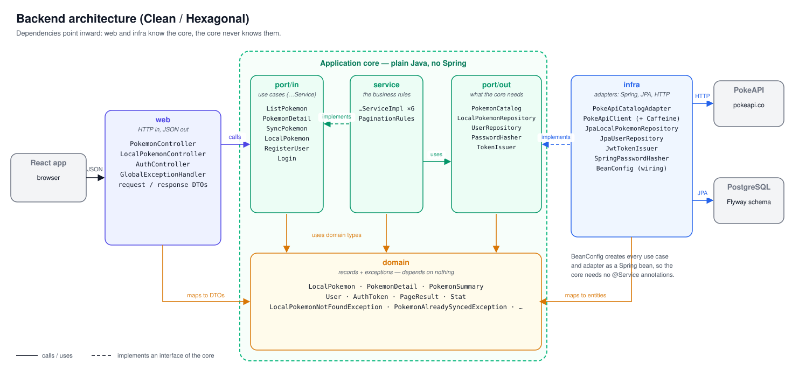

# Pokédex – Ballast Lane Java Technical Exercise

A full-stack application that browses Pokémon from the public [PokeAPI](https://pokeapi.co/docs/v2), saves them into a local PostgreSQL database, and lets authenticated users edit their own fields (localized name, region, tags).

- **Backend:** Java 25, Spring Boot 4.1, Clean Architecture, built with TDD.
- **Frontend:** React 19 + TypeScript + Vite.
- **Infrastructure:** PostgreSQL 18, Flyway, Docker Compose.

---

## Quick start (Docker)

**Requirements:** Docker Desktop (or Docker Engine with Compose v2).

From the repository root:

```bash
docker compose up --build
```

The first build takes a few minutes (it downloads Gradle, Maven dependencies and npm packages).

| What | URL |
|---|---|
| Web app | http://localhost:3000 |
| REST API | http://localhost:8080/api |
| Health check | http://localhost:8080/actuator/health |
| PostgreSQL | `localhost:5432`, database `pokedex`, user `pokedex`, password `pokedex` |

### Demo data

The Docker setup starts with demo data already loaded:

| | |
|---|---|
| **Demo user** | username `user`, password `user` |
| **Saved Pokémon** | Onix (#95) with localized name `Iwark`, region `Kanto` and tags `rock`, `ground`, `gym-brock` |

You can also create a new account from the sign-in screen.

### Useful commands (in the repository root)

| Command | Effect |
|---|---|
| `docker compose up --build -d` | Start in the background |
| `docker compose logs -f backend` | Follow the backend logs |
| `docker compose down` | Stop everything (data is kept in the `pgdata` volume) |
| `docker compose down -v` | Stop everything and delete the database |
| `docker compose exec db psql -U pokedex -d pokedex` | Open a SQL console |

---

## User stories

| Story | What it does | Where |
|---|---|---|
| **US01** Pokémon list | Paginated list with sprite, category, weight and abilities. PokeAPI responses are cached (Caffeine). | `GET /api/pokemon` |
| **US02** Detail | Official artwork, base stats, description and evolution chain. | `GET /api/pokemon/{idOrName}` |
| **US03** Synchronization | Copies a Pokémon from the PokeAPI into the local database, ready for our own fields. | `POST /api/local-pokemon/sync/{idOrName}` |
| **US04** Local modification | Edits only our own fields. `404` if it does not exist, `400` if the payload is invalid. Official data cannot be changed. | `PUT /api/local-pokemon/{id}` |

---

## API

All errors use the RFC 7807 `ProblemDetail` format:

```json
{
  "type": "about:blank",
  "title": "Invalid request",
  "status": 400,
  "detail": "One or more fields are invalid",
  "errors": { "password": "size must be between 8 and 72" }
}
```

### Authentication (public)

| Method | Path | Body | Responses |
|---|---|---|---|
| POST | `/api/auth/register` | `{ "username", "password" }` | `201` user, `400` invalid fields, `409` username taken |
| POST | `/api/auth/login` | `{ "username", "password" }` | `200` `{ accessToken, tokenType, expiresAt }`, `401` invalid credentials |

Protected endpoints need the header `Authorization: Bearer <accessToken>`. Without a valid token they answer `401`.

### PokeAPI catalog (public)

| Method | Path | Responses |
|---|---|---|
| GET | `/api/pokemon?page=0&size=20` | `200` page, `400` invalid pagination (`page >= 0`, `1 <= size <= 100`), `503` PokeAPI unavailable |
| GET | `/api/pokemon/{idOrName}` | `200`, `400` blank identifier, `404` not found, `503` |

### Local collection (requires login)

| Method | Path | Body | Responses |
|---|---|---|---|
| POST | `/api/local-pokemon/sync/{idOrName}` | – | `201` + `Location` header, `404` not in PokeAPI, `409` already synced |
| GET | `/api/local-pokemon?page=0&size=20` | – | `200` page, `400` |
| GET | `/api/local-pokemon/{id}` | – | `200`, `404` |
| PUT | `/api/local-pokemon/{id}` | `{ "localizedName", "region", "tags": [] }` | `200`, `400`, `404` |
| DELETE | `/api/local-pokemon/{id}` | – | `204`, `404` |

Validation for `PUT`: `localizedName` and `region` up to 100 characters; up to 20 tags, each non-blank and up to 50 characters. Tags are normalized (trimmed, lower case, no duplicates). `PUT` replaces the three fields, so a missing field is cleared.

Paged responses share one shape:

```json
{ "content": [ ... ], "page": 0, "size": 20, "totalElements": 1302, "totalPages": 66 }
```

---

## Architecture

The backend follows Clean (hexagonal) Architecture: the business core does not depend on Spring, JPA or HTTP. Dependencies always point inwards.



| Package | Contents | Depends on Spring? |
|---|---|---|
| `domain` | `PokemonSummary`, `PokemonDetail`, `LocalPokemon`, `User`, `PageResult`, domain exceptions | No |
| `application` | Use cases (`ListPokemonService`, `SyncPokemonService`, `LocalPokemonService`, `LoginService`…) and output ports (`PokemonCatalog`, `LocalPokemonRepository`, `UserRepository`, `PasswordHasher`, `TokenIssuer`) | No |
| `infra` | Adapters: PokeAPI (`RestClient` + cache), persistence (JPA entities, Spring Data, mappers), security (JWT, BCrypt), configuration | Yes |
| `web` | REST controllers, request/response DTOs, `GlobalExceptionHandler` | Yes |

Use cases are plain classes. They become Spring beans in `infra/config/BeanConfig` instead of using `@Service`, so the core has no framework annotations.

### Diagrams

| Diagram | What it shows |
|---|---|
| [Architecture](docs/diagrams/architecture.svg) | Layers, ports and adapters, and which way the dependencies point |
| [Request flow (US04)](docs/diagrams/request-flow.svg) | `PUT /api/local-pokemon/{id}` step by step, with the `401`, `400` and `404` exits |
| [Authentication](docs/diagrams/auth-jwt.svg) | Login → JWT, and how every protected request is checked |
| [Data model](docs/diagrams/data-model.svg) | Tables, keys and constraints, and how they map to Java classes |
| [Deployment](docs/diagrams/deployment.svg) | What `docker compose` starts, compared with local development |
| [Frontend](docs/diagrams/frontend.svg) | React components, state and the `api.ts` adapter |

### Main design decisions

- **Separate domain records and JPA entities.** Entities live only in `infra/persistence`, and a mapper converts between them. The domain stays free of JPA annotations.
- **Database schema owned by Flyway.** Hibernate only validates it (`ddl-auto: validate`). A unique constraint on `pokeapi_id` guards against duplicate syncs, even when two requests arrive at once.
- **Caching with Caffeine.** Caching happens at the PokeAPI client level (in-memory, 24h). It is a single instance, so Redis would add infrastructure without a benefit here.
- **Timeouts on PokeAPI calls.** Failures of the PokeAPI are translated to `503` instead of `500`.
- **JWT with Spring Security's OAuth2 resource server.** Tokens are signed with HS256, with no hand-written security filter. Passwords are hashed with BCrypt.
- **Same message for unknown user and wrong password.** The login cannot be used to discover which usernames exist.
- **US04 rule enforced twice.** The domain method `withCustomFields` only receives our own fields, and the persistence adapter only copies those fields.
- **No N+1 queries on tags.** Pagination is ordered by id, and tags are loaded with `@BatchSize`, which avoids one extra query per Pokémon.
- **Frontend talks only to `/api` on its own origin.** Vite (development) or nginx (Docker) forwards the calls to the backend, so no CORS configuration is needed.

---

## Tests

The tests follow TDD and are organized per layer. **Docker must be running**, because the persistence and integration tests use Testcontainers (real PostgreSQL).

```bash
cd backend/bla-excercise
./gradlew test          # Windows: .\gradlew.bat test
```

Every test run also writes a coverage report (JaCoCo): open `backend/bla-excercise/build/reports/jacoco/test/html/index.html` in a browser.

| Layer | Tools | Examples |
|---|---|---|
| Domain | JUnit 5, AssertJ | `LocalPokemonTest` |
| Use cases | JUnit 5, Mockito | `ListPokemonServiceTest`, `SyncPokemonServiceTest`, `LocalPokemonServiceTest`, `LoginServiceTest` |
| PokeAPI adapter | WireMock, JSON fixtures | `PokeApiCatalogTest`, `PokeApiClientCacheTest` |
| Persistence | `@DataJpaTest` + Testcontainers | `JpaLocalPokemonRepositoryTest`, `JpaUserRepositoryTest` |
| Security | Real JWT encoder/decoder | `JwtTokenIssuerTest` |
| Web | `@WebMvcTest` + MockMvc | `PokemonControllerTest`, `LocalPokemonControllerTest`, `AuthControllerTest` |
| End to end | `@SpringBootTest` + Testcontainers | `AuthFlowIntegrationTest` (register → login → protected endpoint) |

---

## Local development (without Docker for the app)

**Requirements:** JDK 25, Node.js 22+, Docker (for the development database).

1. **Backend.** Start PostgreSQL in a Testcontainer together with the app (port 8080):

   ```bash
   cd backend/bla-excercise
   ./gradlew bootTestRun
   # with the demo data:
   ./gradlew bootTestRun --args='--spring.profiles.active=demo'
   ```

2. **Frontend.** Start the dev server (http://localhost:5173), which proxies `/api` to `localhost:8080`:

   ```bash
   cd frontend
   npm install
   npm run dev
   ```

---

## Configuration

| Variable / property | Default | Purpose |
|---|---|---|
| `SPRING_DATASOURCE_URL`, `_USERNAME`, `_PASSWORD` | set by Docker Compose / Testcontainers | Database connection |
| `JWT_SECRET` (`app.jwt.secret`) | development key in `application.yaml` | Base64 key, at least 32 bytes. **Set your own outside local development** (`openssl rand -base64 32`). |
| `app.jwt.expiration` | `1h` | Token lifetime |
| `app.pokeapi.base-url` | `https://pokeapi.co/api/v2` | PokeAPI base URL |
| `app.pokeapi.connect-timeout` / `read-timeout` | `3s` / `5s` | PokeAPI timeouts |
| `app.pagination.max-page-size` | `100` | Maximum page size |
| `SPRING_PROFILES_ACTIVE=demo` | on in Docker Compose | Loads the demo data (`db/seed`) |

---

## Project structure

```
backend/bla-excercise/
  src/main/java/com/ballastlane/blaexcercise/
    domain/          model + exceptions
    application/     port/in, port/out, service
    infra/           pokeapi, persistence, security, config
    web/             controllers, model (DTOs), errors
  src/main/resources/
    application.yaml, application-demo.yaml
    db/migration/    Flyway schema (V1 local_pokemon, V2 users)
    db/seed/         demo data (only with the "demo" profile)
genAI/              task API generated for the GenAI exercise (separate project)
docs/diagrams/      architecture, request flow, auth, data model, deployment, frontend (SVG)
frontend/
  src/
    api.ts           all HTTP calls, token handling and errors
    types.ts         TypeScript types matching the API responses
    pages/           LoginPage, CatalogPage, CollectionPage
    components/      PokemonDetail, EditPokemonForm, Pagination
compose.yaml         PostgreSQL + backend + frontend
backend/bla-excercise/Dockerfile
frontend/Dockerfile, frontend/nginx.conf
```

---

## Generative AI

See [GENAI.md](GENAI.md). The task-management API generated for that exercise is a separate Gradle project in [`genAI/`](genAI/); it is not part of the Pokédex application or its Docker setup.
